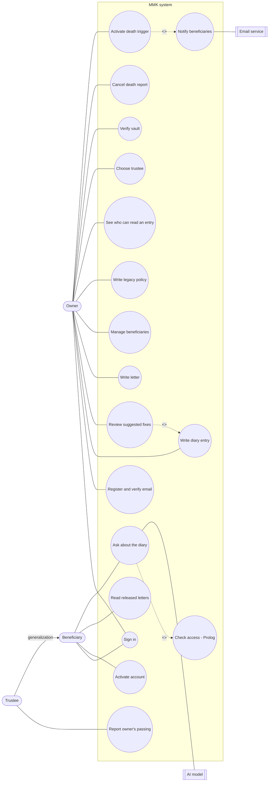
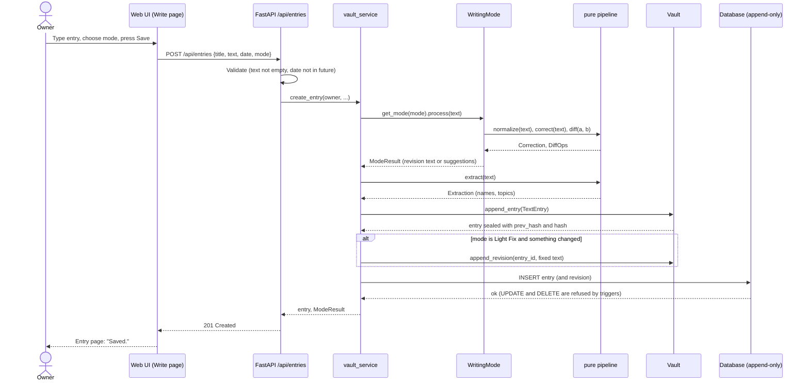
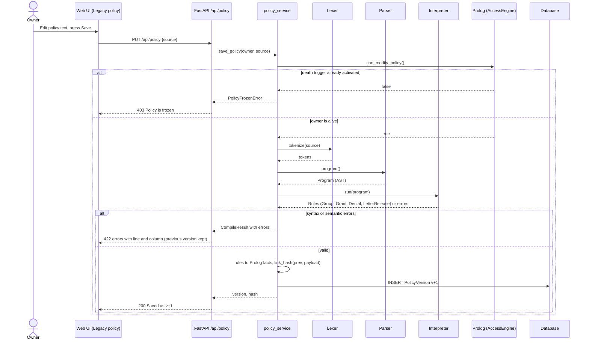
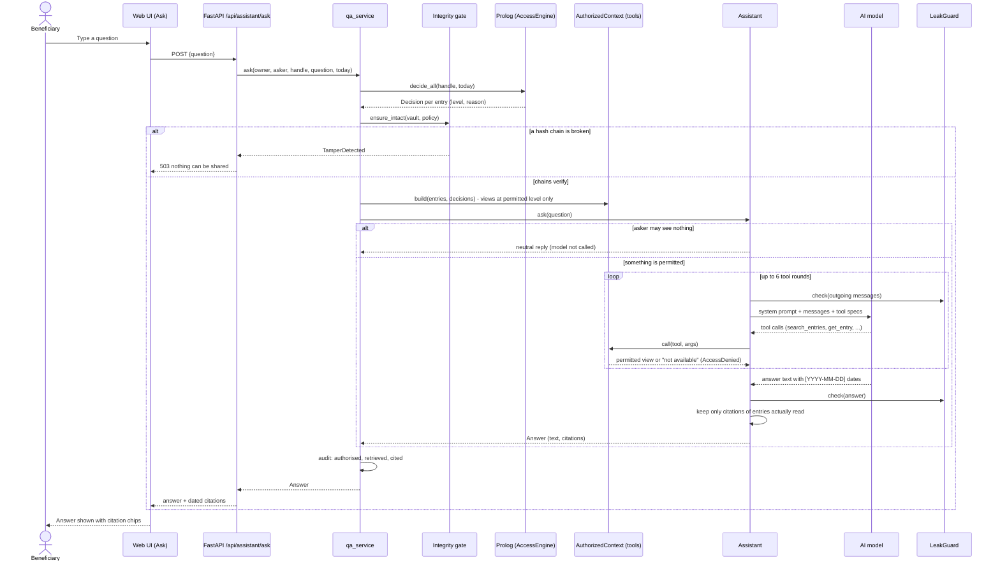
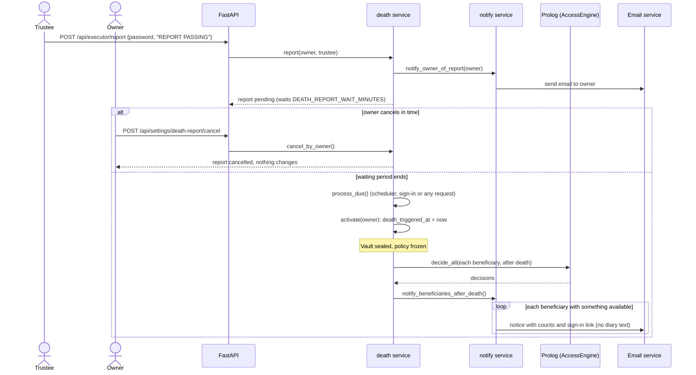
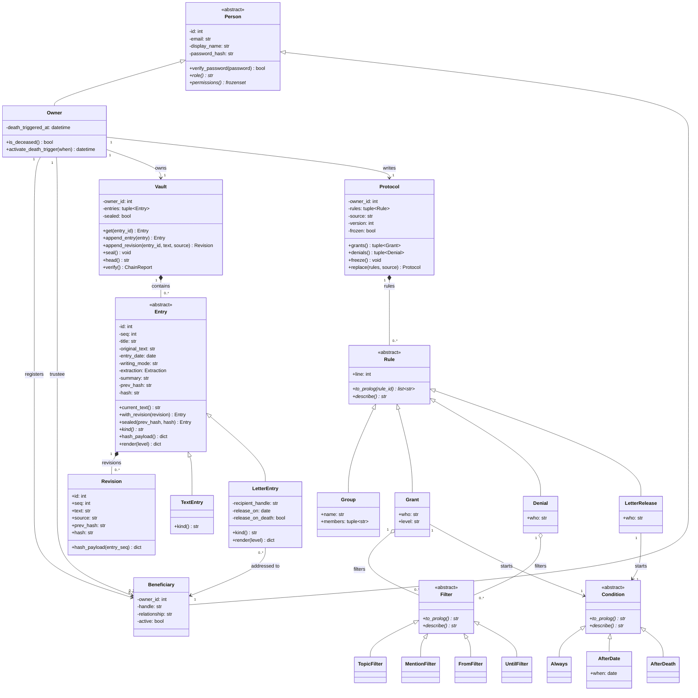
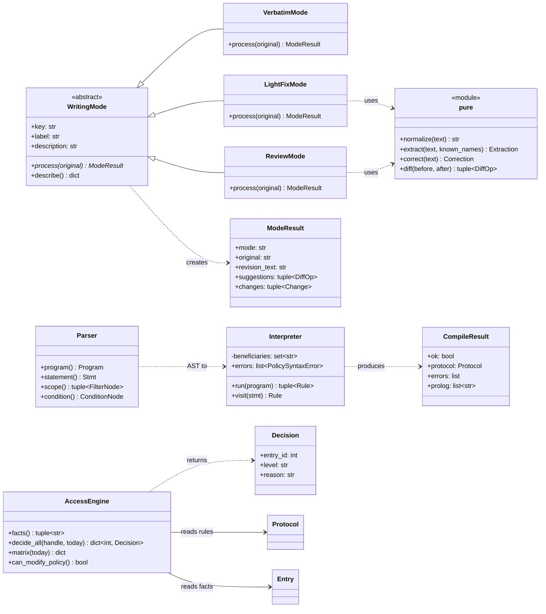
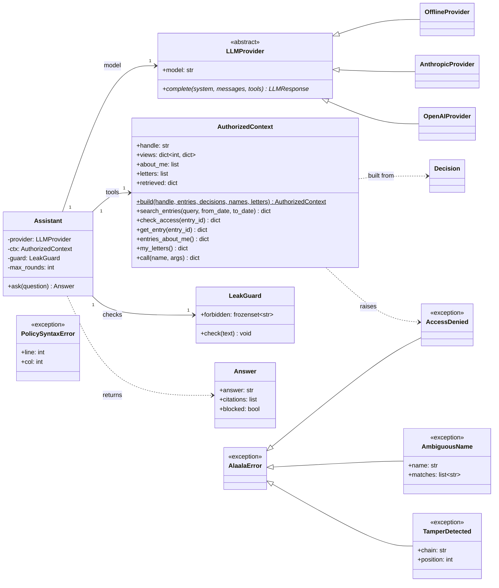

# UML Diagrams (Task 1.05)

> **Team:** Leonel C. Bulawan (Project Manager) · Gabriel E. Liray (Lead Developer) · Kean Jayvee B. Gito (QA/Tester) · Robylyn U. Flores (UI/UX Designer)

Three UML diagrams of MMK, drawn from the final requirements in [PROPOSAL.md](PROPOSAL.md) (version 1.0) and checked against the code in `backend/app/`. GitHub renders the Mermaid blocks below as diagrams. The same diagrams, with a fully drawn Use Case Diagram, are in the shared doc: [MMK – UML Diagrams (Task 1.05)](https://claude.ai/artifact/Fc8rMdQQSPN3hfUrKzfWQU).

## 1. Use Case Diagram

Mermaid has no use case diagram type, so this is the same diagram written as a graph: stick-figure actors are shown as named nodes, use cases as rounded ovals inside the **MMK system** boundary, dashed arrows are `<<include>>` / `<<extend>>`, and the hollow arrow is generalization (a Trustee is a Beneficiary).

## 2. Sequence Diagrams

### 2.1 Owner saves a diary entry (FR-D1–D6, FR-W1–W4)

### 2.2 Owner saves the legacy policy (FR-P1–P5, FR-R7)

### 2.3 Beneficiary asks a question (FR-AI1–AI12, FR-R1–R9)

### 2.4 Trustee reports the owner's passing (FR-T1–T5)

## 3. Class Diagram

`-` private (read through a property), `+` public, `*` abstract method, `$` class method.

### 3.1 Diary model (C1)

### 3.2 Writing modes, policy language and access rules (C2–C5)

### 3.3 AI layer and typed exceptions (C6)

